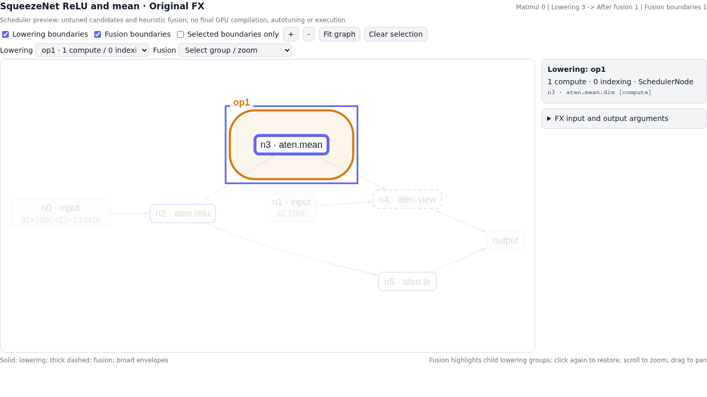
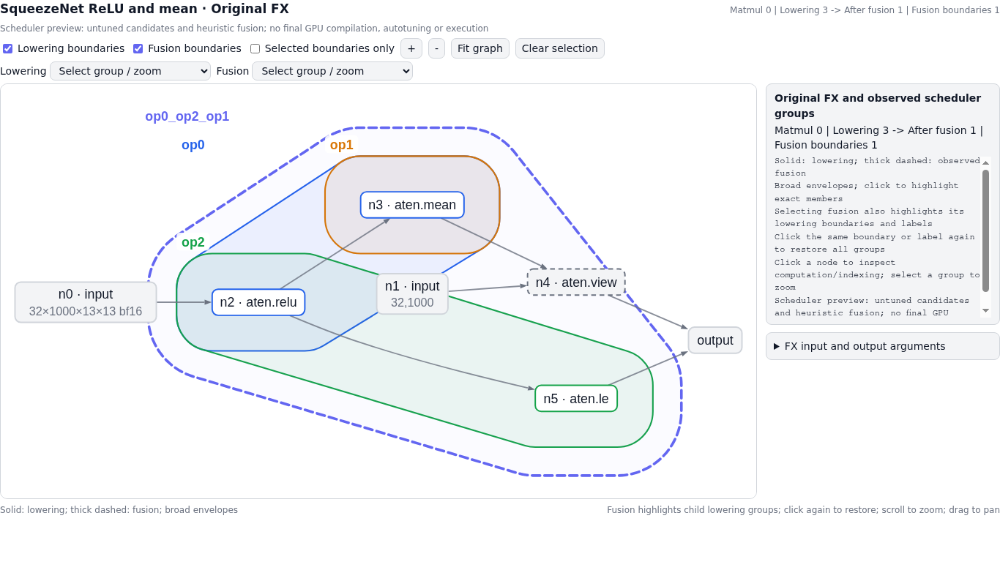

# FX Visualizer

Inspect how a captured `torch.fx.GraphModule` maps to Inductor lowering and
fused scheduler nodes. The default API is `visualize_graph`: pass your FX graph
and its example inputs directly. Better Benchmark integration is optional.

Capture stops after scheduler fusion, before final kernel codegen, autotuning
or compiled execution. The viewer shows the observed heuristic schedule.

## Install

Use a Python environment with compatible PyTorch/Inductor and Graphviz's `dot`
executable. Then, from this repository:

```bash
python -m pip install -e .
```

Saved captures can be rendered with Python and Graphviz alone. Live capture uses
PyTorch private compiler APIs; see [compatibility and API details](docs/api.md).

## Start from an FX graph

This example captures the same ReLU, mean, view and comparison pattern shown
below. You can pass an existing `GraphModule` in place of `gm`.

```python
import torch
from fx_visualizer import visualize_graph

def forward(x, output_shape):
    activated = torch.ops.aten.relu.default(x)
    mean = torch.ops.aten.mean.dim(activated, [-1, -2], True)
    pooled = torch.ops.aten.view.default(mean, output_shape)
    mask = torch.ops.aten.le.Scalar(activated, 0)
    return pooled, mask

gm = torch.fx.symbolic_trace(forward)  # Capture a directed ATen FX graph.
example_inputs = (
    torch.randn(32, 1000, 13, 13, dtype=torch.bfloat16, device="cuda"),
    [32, 1000],
)

result = visualize_graph(
    gm=gm,  # Your captured torch.fx.GraphModule.
    example_inputs=example_inputs,  # Inputs in forward argument order.
    output_dir="fx_demo",  # Folder for HTML, SVG, JSON and compiler evidence.
    config=None,  # Optional Inductor overrides, e.g. {"epilogue_fusion": False}.
    title="ReLU and mean",
)
print(result["html"])  # Absolute path to the interactive HTML page.
```

Run the complete example with `python examples/relu_mean.py`, then open the
printed HTML path in a browser. Tensor shapes, strides, dtype, device, storage
offsets, aliases and nested arguments are retained. All API arguments are
keyword-only.

## Read and select scheduler boundaries



The screenshot shows `op1` selected in the ReLU/mean pattern:

- **Solid boundaries** show lowering groups; **dashed boundaries** show fused
  scheduler groups. Broad rounded envelopes keep the directed graph readable.
- `op0` performs ReLU and the mean's sum reduction. `op1` reads that result,
  divides by `13 * 13 = 169` and converts the dtype. Both correspond to the same
  original `mean` FX node; only `op0` performs ReLU.
- Click a boundary or its label to highlight its actual FX members and fade
  other nodes. Here, only `mean` is highlighted. Click again to reset.
- Selecting a fused boundary also highlights its constituent lowering
  boundaries. Selecting an FX node shows its arguments, geometry and scheduler
  membership in the inspector.
- Expand **FX input and output arguments** to inspect the original arguments
  and return structure. Layer toggles, group selectors, zoom and pan are available.

<details>
<summary>Show the original FX graph with lowering and fusion boundaries</summary>



</details>

## Optional: connect Better Benchmark

Point the adapter at an existing Better Benchmark checkout. The visualizer uses
that checkout's repro, saved input configurations and compile policies.

```python
from fx_visualizer.integrations.better_benchmark import visualize_repro

result = visualize_repro(
    bb_root="/path/to/better-benchmark",  # Existing BB checkout.
    repro_path="repros/canonical/mean_2a13f6e9f02f",  # Relative to bb_root.
    output_dir="fx_demo_bb",
    configuration=0,  # First saved input configuration; a saved key also works.
    config=None,  # Optional compiler overrides; saved policies are respected.
)
print(result["html"])
```

BB stays in its own repository. The adapter imports its existing helpers only
when called. No BB corpus, harness code or matmul extraction code is bundled
here. If you already have a BB `GraphModule` and inputs, call `visualize_graph`
directly.

## Saved artifacts and further APIs

`output_dir` contains:

- `result["html"]`: standalone interactive viewer.
- `result["svg"]`: static graph image.
- `result["widget"]`: embeddable interactive viewer.
- `result["payload"]`: graph layout and boundary memberships as JSON.
- `result["capture"]`: original FX/input metadata and compiler evidence as JSON.

Use `render_capture` to render saved evidence without another compiler run.
For GEMM graphs, `visualize_matmul_comparison` adds Template / Native buttons.
See the [API reference](docs/api.md) for examples and limitations.

## Development

```bash
python -m unittest discover -s tests -p 'test_fx_visualizer*.py'
```

Tests for the optional BB adapter's real input generators run when BB helpers
are available. The core viewer and capture API run independently of BB.

## License

MIT. This package was extracted from the FX visualizer developed alongside
[Better Benchmark](https://github.com/eellison/better-benchmark). See [LICENSE](LICENSE).
